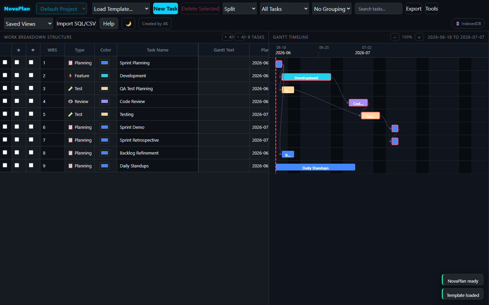

# NovaPlan — Free Single-File Project Planner

**A complete project management tool packed into one HTML file — Gantt chart, WBS, critical path, Kanban board, sprint planning, RAID log, and more.**

NovaPlan is a zero-install, offline-first project planner. No sign-up, no server, no internet connection required after the first load. Your data is stored locally in your browser and never leaves your device.

Use it to plan projects, track tasks and subtasks, manage sprints, visualise timelines on an interactive Gantt chart, run critical-path analysis, balance resource workload, track risks, and share progress as Excel or animated GIF exports.

**[🚀 Launch App](https://aravindksk7.github.io/NovaPlan/NovaPlan.html) · [⬇ Download HTML](https://raw.githubusercontent.com/aravindksk7/NovaPlan/main/NovaPlan.html) · [🌐 Project Page](https://aravindksk7.github.io/NovaPlan/)**

---

## Quick Start

1. **Download** [`NovaPlan.html`](NovaPlan.html).
2. **Open it** by double-clicking the file (it runs on the `file://` protocol) or serving it from any web server / static host.
3. Click **`Load Template…` → Agile Sprint Plan** to see a fully built example, or click **`New Task`** to start from scratch.

That's it — no build step, no dependencies to install. The entire application is self-contained in a single file.

> 💡 For the best storage experience (unlimited size, fastest saves) serve the file over `http(s)` or `localhost`. Opening directly via `file://` also works and uses IndexedDB automatically.

---

## Key Features

- **Work Breakdown Structure** — unlimited task nesting with automatic roll-up of dates, hours, and progress to parent (summary) rows.
- **Interactive Gantt chart** — colour-coded bars, dependency arrows, progress fills, baseline bars, actual-date tracks, milestones, and 8 zoom levels (25%–400%).
- **Critical Path Method (CPM)** — automatic forward/backward pass with total-float calculation and critical / near-critical flagging.
- **Dependencies** — all four link types (FS, SS, FF, SF) with lead/lag in days or hours, circular-dependency detection, and **automatic re-scheduling** when you set a predecessor.
- **13 industry-standard task types** — Epic, Story, Task, Feature, Bug, Spike, Test, Docs, Infra, Review, Deploy, Maint, Planning — each with its own colour.
- **Custom bar colours** — override any task's colour with a click.
- **8 views** — Split, Grid, Gantt, Board (Kanban), Sprint, Dashboard, Workload, RAID.
- **Sprints, baselines, scenarios, RAID log, and change log** — full project-governance toolkit.
- **Working calendar** — configurable working days, hours per day, and holidays drive all duration maths.
- **Show/hide columns** — tailor the grid to what you need.
- **Dark / light theme** — toggle and remember your preference.
- **Import / Export** — SQL (full backup), CSV, Jira CSV, MS Project XML, multi-sheet Excel, and Gantt GIF.
- **Local-first storage** — OPFS → IndexedDB → localStorage, chosen automatically; nothing is ever uploaded.
- **Professional UX polish** — scrollable modals with sticky headers/footers, responsive toolbar with flex-wrap, Tools menu dropdown overlays all content and smart-positions itself to stay within the viewport at any screen width.

---

## Recent Improvements (June 2026)

### Tools Dropdown Overlay — Fixed

The Tools menu dropdown now correctly overlays the Work Breakdown Structure grid and Gantt timeline at all viewport sizes:

- **Proper overlay** — The panel uses `position: fixed` with `z-index: 9999`, escaping the topbar's `overflow-x: auto` clipping context that previously hid the dropdown
- **Glassmorphism fix** — `backdrop-filter` moved from the menu container onto the panel itself; a `backdrop-filter` on a container element creates a CSS containing block that mis-positioned the fixed-position panel
- **Smart positioning** — When the toolbar wraps and the Tools button lands on the left half of the viewport, the panel left-aligns with the button and opens to the right. When the button is on the right half, it right-aligns. Both paths clamp to viewport bounds, so the panel is always fully visible regardless of screen width
- **All 17 items accessible** — Visibility logic unchanged; Gantt-specific items (Gantt Labels, Gantt Lines) are hidden only in non-Gantt views

### Earlier UX Polish

- **Scrollable modals with sticky header/footer** — Long forms scroll within the modal; OK/Cancel buttons remain pinned and visible at all times
- **Responsive toolbar** — Flex-wrap layout adapts to any screen width; all controls accessible with no hidden elements

---

## Tech Stack

NovaPlan is a single HTML file using a handful of CDN-loaded libraries:

- **[sql.js](https://github.com/sql-js/sql.js)** — SQLite compiled to WebAssembly, the in-browser database engine.
- **[SheetJS](https://sheetjs.com/)** — Excel workbook export.
- **[gifenc](https://github.com/mattdesl/gifenc)** — Gantt GIF generation.
- **[Tailwind CSS](https://tailwindcss.com/)** (CDN) — utility styling.

Everything else — the grid, the Gantt renderer (hand-built SVG), the CPM engine, and the storage layer — is vanilla JavaScript with no framework.

---

# User Guide

The full in-app help is reproduced below so you can read it without opening the app.

## Getting Started in 5 Steps

1. **Load a template or create a task.** Click `Load Template…` to start from a pre-built plan, or click `New Task` (blue button) to add a blank task.
2. **Click any cell to edit it.** Click the Task Name to rename it. Click dates, progress, status, or any highlighted column to change the value inline.
3. **Add subtasks.** Click the `+` button at the far right of any row to add a child task underneath it. The parent row rolls up all child values automatically.
4. **Switch views.** Use the `View` dropdown to see your plan as a Gantt chart, a Kanban board, a sprint board, a workload table, or a dashboard. **Split** shows the grid and Gantt side by side.
5. **Save and export.** Your data saves automatically in the browser. Use `Export` to download a backup (SQL), a spreadsheet (Excel), or a shareable Gantt image (GIF).

## The Top Toolbar — Every Button Explained

| Control | What it does |
|---|---|
| `Load Template…` | Loads a ready-made plan: **Agile Sprint Plan**, **CI/CD Pipeline Setup**, **Product Launch**, or **Bug Triage Workflow**. Choose *Merge* to add tasks alongside existing ones, or *Replace* to start fresh. |
| `New Task` | Creates one blank top-level task starting today. The title cell opens for editing immediately. |
| `Delete Selected` | Deletes all checked (selected) tasks and their subtasks. Only active when at least one checkbox is ticked. |
| `View` | Switches between 8 views: Split, Grid, Gantt, Board, Sprint, Dashboard, Workload, RAID. |
| `Filter` | Shows a subset of tasks — e.g. only Slipped, only Milestones, only Critical Path tasks. |
| `Group By` | Re-orders and groups rows by Status, Sprint, Resource, Priority, Task Type, or Slippage. |
| `Export` | Downloads your plan in SQL, CSV, Jira CSV, Project XML, Excel, or Gantt GIF format. |
| `Tools` | Advanced features: Calendar settings, Choose Columns, Baselines, Sprint management, Saved views, Scenarios, RAID items, Change logging, Reset data. |
| `Saved Views` | Pre-set view configurations (mode + filter + grouping). Six defaults included; save your own via `Tools > Save View`. |
| `Import SQL/CSV/Excel` | Loads tasks from a CSV file or Excel workbook, or restores a full database from a previously exported SQL file. |
| `Help` | Opens the in-app help dialog. |
| 🌙 / ☀️ | Toggles between dark and light theme. Your preference is remembered. |

## Creating and Editing Tasks

**Adding tasks**
- Click `New Task` to add a root-level task. It starts today with 1 working day duration.
- Click `+` at the end of any row to add a **child (subtask)** directly under that row. The parent automatically becomes a summary row.
- Use `Load Template…` for a fully wired plan with dates, types, resources, and dependencies already set.

**Editing cells** — Click any underlined or highlighted cell to edit it. A text input, date picker, or dropdown appears. Press **Enter** to confirm, **Escape** to cancel. Most cells save on click-away.

**Deleting tasks** — Click `×` at the end of the row. If the task has subtasks, all subtasks are deleted too. For bulk deletion, tick the checkboxes (first column) and click `Delete Selected`.

## Task Hierarchy: Parents and Subtasks

NovaPlan supports unlimited nesting. Each task has a **WBS code** (e.g. `1`, `1.1`, `1.1.2`) that shows its position in the hierarchy.

- Click `+` on any row to add a subtask beneath it. The parent row turns **bold** — it is now a *summary row*.
- Summary rows **automatically roll up** dates (earliest start → latest end), hours (sum), and progress (weighted average).
- Click the **▾** (down triangle) next to a parent task name to collapse all its subtasks. Click **▸** to expand them again.
- Use **▸ All** and **▾ All** buttons in the panel header to collapse or expand the entire hierarchy at once.

> 💡 Structure your plan with top-level tasks as phases or epics, and subtasks as individual work items. This keeps the Gantt chart readable and rollup metrics meaningful.

## Task Types

Every task has a type that sets its default Gantt bar colour and helps categorise work. Click the `Type` cell to change it.

| Type | Colour | When to use |
|---|---|---|
| 🎯 Epic | Purple | Large initiative spanning multiple stories or features |
| 📖 Story | Cyan | A user story or functional requirement |
| ✅ Task | Blue | Generic work item (default for new tasks) |
| ⚡ Feature | Teal | New capability being built |
| 🐛 Bug | Red | Defect or issue to fix |
| 🔬 Spike | Emerald | Research or investigation with time-boxed outcome |
| 🧪 Test | Yellow | QA, testing, or validation work |
| 📚 Docs | Gray | Documentation, runbooks, or knowledge base updates |
| 🏗️ Infra | Orange | Infrastructure, DevOps, or platform work |
| 👁️ Review | Violet | Code review, design review, or approval |
| 🚀 Deploy | Purple | Release or deployment activity |
| 🔧 Maint | Amber | Maintenance, refactoring, or tech debt |
| 📋 Planning | Blue | Planning ceremonies, meetings, kickoffs |

## Custom Bar Colours

The `Color` column lets you give any task its own Gantt bar colour, overriding its task-type colour. This is handy for highlighting a workstream, a team, or a release train at a glance.

1. Click the colour **swatch** in the `Color` column for the task you want to recolour.
2. Pick any colour from your browser's colour picker. The Gantt bar and the task's Board card update immediately.
3. A custom colour is marked with a cyan ring around the swatch and a **✕** button appears next to it.
4. Click **✕** to remove the custom colour and revert to the task-type colour.

> 💡 Custom colours are saved with your plan and included in SQL, CSV, and Excel exports (the `Color` column), so they survive backup and restore.

## Dates, Duration, and the Working Calendar

- **Plan Start / Plan End** — the *scheduled* dates for a task. Click either cell to open a date picker. On summary rows, start and end roll up automatically from child tasks.
- **Duration (Dur)** — read-only, calculated from the start/end dates using the working calendar (e.g. `3d 4h` = three working days and four hours). `Hours` and `Plan End` stay in step: changing `Plan End` recalculates `Hours`, and typing `Hours` moves `Plan End`.
- **Actual Start / Actual End** — fill these in as work progresses. They're compared with planned dates to calculate slippage. Actual-date bars appear below the Gantt bar in a lighter colour.

**Working Calendar** — by default the working week is Monday–Friday, 8 hours per day. Go to `Tools > Calendar Settings` to change:
- **Hours per day** — e.g. enter `7.5` for a 7.5-hour day.
- **Working days** — enter day numbers: `1,2,3,4,5` = Mon–Fri; `0` = Sunday; `6` = Saturday.
- **Holidays** — enter dates as `YYYY-MM-DD` separated by commas.

> 💡 The calendar affects duration calculations, workload spreading, and non-working-day shading on the Gantt chart.

## Progress and Status

Enter a number from 0 to 100 in the `%` column. NovaPlan automatically updates the Status and Remaining Hours fields to match.

| Progress | Auto Status |
|---|---|
| 0% | Not Started |
| 1–99% | In Progress |
| 100% | Done |

Status has four values: **Not Started**, **In Progress**, **Blocked**, **Done**. Progress drives status automatically, but you can override it manually. Summary (parent) rows inherit the *worst* status from their children — if any child is Blocked, the parent shows Blocked.

**Hours tracking**
- `Hours` — planned effort
- `Actual h` — hours logged so far
- `Remain h` — hours left to complete (auto-calculated from progress, editable)
- `EAC h` — Estimate at Completion = Actual + Remaining (read-only)

## Task Dependencies

Dependencies define which tasks must happen before others. Enter them in the `Predecessors` column using WBS codes.

**Format:** `{WBS code}{Type}{Lag}` — all parts except WBS are optional.

| Example | Meaning |
|---|---|
| `2` | Task 2 must finish before this task starts (Finish-to-Start, no lag) |
| `1.2` | Subtask 1.2 must finish before this starts |
| `2FS+2d` | Task 2 must finish, then wait 2 more working days before this starts |
| `3SS` | This task must start at the same time as task 3 (Start-to-Start) |
| `4FF-1d` | This task must finish 1 day before task 4 finishes (Finish-to-Finish with lead) |
| `1,3FS+4h` | Multiple predecessors separated by commas |

**Dependency types**

| Type | Full name | Meaning |
|---|---|---|
| `FS` | Finish-to-Start | Default. Predecessor must finish before successor starts. |
| `SS` | Start-to-Start | Both tasks start at the same time. |
| `FF` | Finish-to-Finish | Both tasks finish at the same time. |
| `SF` | Start-to-Finish | Predecessor starts before successor can finish. Rare. |

Lag is in working days (`d`) or hours (`h`). Positive lag = gap; negative lag = overlap (lead).

> 💡 When you set a predecessor, NovaPlan **automatically reschedules** the task's start/end dates to respect the constraint. Dependency arrows appear on the Gantt chart as curved lines with arrowheads, and circular dependencies are detected and blocked.

**Rescheduling** — whenever a task's dates change (grid, details drawer, or dragging its Gantt bar), every task that depends on it moves too, keeping its own length. Summary tasks move by shifting their subtasks.

- Dragging a bar moves it in whole days and skips non-working days. Moving a bar keeps its `Hours`; dragging an edge resizes it and updates `Hours`.
- A dependent task cannot be placed earlier than its predecessors allow. Dragging stops at the earliest allowed date; a date typed in the grid or drawer is rejected.
- Placing a dependent task later than it needs to be records the gap as lag (for example `1FS` becomes `1FS+2d`), so the gap is kept when the predecessor moves. Move it back to remove the lag.

## The Gantt Timeline

The Gantt chart shows each task as a horizontal bar spanning its planned start to end date, aligned with the task rows in the grid.

**Reading the chart**

| Visual element | What it means |
|---|---|
| Coloured bar | Planned schedule, from Plan Start to Plan End including any non-working days in between. Colour matches the task type (or custom colour). |
| Darker fill inside bar | Completed portion (progress %). |
| Thin bar below main bar | Actual start/end dates (white, or red if slipped). |
| Thin gray bar below | Baseline dates (where the task was when you set the baseline). |
| Diamond shape | Milestone (zero-duration checkpoint). |
| Red stroke/border on bar | Task is on the Critical Path or has slipped. |
| Orange stroke on bar | Task is at risk of slipping. |
| Cyan glow on bar | Task has been starred (★ highlighted). |
| Shaded columns | Non-working days (weekends and holidays). |
| Curved arrows | Dependencies between tasks. |

**Zooming** — use the `−` and `+` buttons in the Gantt panel header. Eight levels from 25% (very wide) to 400% (detailed daily). Date-tick spacing adjusts automatically.

**Hovering** — hover over any Gantt bar for a tooltip with full task details: planned dates, actual dates, duration, float, progress, sprint, resource, Jira link, and baseline finish.

**Timeline text**

- Click a bar to set its own text, then choose a position (above, middle, below, before, after) and an alignment (left, center, right).
- Pick a size (small, medium, large) and bold or italic.
- Text too long for its bar moves to the right of the bar; switch to truncation in `Tools → Gantt Label Settings`.
- Text that would run off the right end of the timeline is placed to the left of its bar instead.
- Text on a bar picks dark or white automatically for contrast unless you choose a colour.
- `Tools → Gantt Label Settings` sets the default position, alignment, size and overflow behaviour for all bars.

## Views — Eight Ways to See Your Plan

| View | Best for | How to use |
|---|---|---|
| **Split** | Day-to-day management | Grid on the left, Gantt on the right. The default view. |
| **Grid** | Data entry, bulk editing | Full-width task table. Edit many fields quickly without the Gantt. |
| **Gantt** | Schedule presentations | Full-width Gantt. Great for sharing with stakeholders. |
| **Board** | Kanban workflow | Drag-and-drop cards grouped by status, sprint, resource, or type. |
| **Sprint** | Sprint planning | Board pinned to sprint grouping. Shows sprint hours and team size. |
| **Dashboard** | Project health at a glance | 12 metric cards: critical tasks, slippage, work remaining, RAID count, etc. |
| **Workload** | Resource balancing | Table showing each person's total hours, max daily load, and overloaded days. |
| **RAID** | Risk & change tracking | Two tables: RAID log (Risks, Assumptions, Issues, Decisions) and Change Log. |

> 💡 **Saved Views** remember your favourite combinations of view + filter + grouping. Load them from the `Saved Views` dropdown (six defaults pre-loaded, or save your own via `Tools > Save View`).

## Filtering and Grouping

The `Filter` dropdown narrows what is shown in the grid and Gantt without deleting anything.

| Filter | Shows |
|---|---|
| All Tasks | Everything (default) |
| Slipped | Tasks where actual dates are later than planned |
| At Risk | Tasks whose planned end has passed but are not 100% done |
| Milestones | Tasks marked with ◆ |
| Current Sprint | Tasks in the active sprint |
| Future Sprints | Tasks in sprints that haven't started yet |
| Backlog | Tasks not assigned to any sprint |
| Completed | Tasks at 100% or status Done |
| Blocked | Tasks with status Blocked |
| Critical Path | Tasks with zero float (any delay = project delay) |
| Near Critical | Tasks with float ≤ 2 days |
| Unassigned | Tasks with no resource set |
| Baseline Variance | Tasks that have drifted from the saved baseline |

The `Group By` dropdown sorts and groups tasks by **Status**, **Sprint**, **Resource**, **Priority**, **Task Type**, or **Slippage**. Set it back to *No Grouping* to return to WBS order.

## Row Colour Coding

Row backgrounds give you instant health signals.

| Row colour | Meaning |
|---|---|
| Red tint | **Slipped** — actual start or end date is later than planned. |
| Orange tint | **At Risk** — planned end date has passed but the task isn't done. |
| Cyan left bar | **Highlighted (★)** — manually flagged for attention. |
| Red left bar only | **Critical Path** — zero float; any delay pushes the project end date. |
| **Bold** | **Summary row** — this task has subtasks; values are rolled up. |
| ◆ prefix in title | **Milestone** — a zero-duration checkpoint; shown as a diamond on the Gantt. |
| Yellow text in Var columns | **Baseline variance** — current dates differ from the saved baseline. |

## Sprints

**Creating a sprint**
1. Go to `Tools > Add Sprint`.
2. Enter the sprint name (e.g. *Sprint 1*), start date, and end date.
3. Click OK — the sprint appears in the `Sprint` column dropdown for all tasks.

**Assigning tasks** — click the `Sprint` cell in any task row and choose a sprint. Tasks with no sprint show as *Backlog*.

**Sprint view** — switch to `View → Sprint` for a Kanban board with one column per sprint plus a Backlog column. Drag cards between columns to reassign sprints. The header shows total sprint hours and the number of resources allocated.

> 💡 Use `Filter → Current Sprint` in Split view to focus the grid and Gantt on just this sprint's tasks.

## Baselines: Comparing Plan vs Reality

A baseline is a snapshot of your planned schedule saved at a point in time. As the project progresses, you can see exactly how much tasks have slipped compared to the original plan.

**Setting a baseline**
1. Once your plan is finalised (dates, hours, resources all set), go to `Tools > Set Baseline`.
2. Give it a name (e.g. *Baseline 2026-01-15*) and confirm.
3. NovaPlan saves every task's dates, duration, and progress as the reference point.

**Seeing variance** — the grid shows two columns: `Base End` (baseline finish date) and `Finish Var` (difference in days; positive = later than planned). On the Gantt, a thin gray bar below each task bar shows the baseline position.

**Managing baselines**
- `Tools > View Baseline` — see the active baseline name and how many tasks have variance.
- `Tools > Clear Baseline` — deactivates the baseline (historical data is kept, but variance is no longer shown).

> 💡 **Best practice:** Set a baseline before project kick-off. Update it after each approved scope change. Use `Filter → Baseline Variance` in weekly reviews to spot drifting tasks.

## Workload View: Who's Doing What

Switch to `View → Workload` for a resource allocation summary.

| Column | Meaning |
|---|---|
| Resource | Person or team name (from the Resource column on tasks) |
| Tasks | Number of tasks assigned |
| Total Hours | Sum of all planned hours across their tasks |
| Max Daily Load | The busiest single working day for this person |
| Overloaded Days | Number of days where their load exceeds the calendar's hours-per-day limit |

Rows with overloaded days are listed first — they need attention. Fix overloads by adjusting task dates, splitting tasks, or reassigning resources.

## Board View: Drag-and-Drop Workflow

Switch to `View → Board` to see tasks as cards arranged in columns. The `Group By` dropdown controls what the columns represent. Drag a card from one column to another and the task's field updates automatically:

| Grouped by | What changes when you drag |
|---|---|
| Status | Task status updates (e.g. drag to "Done" → progress set to 100%) |
| Priority | Task priority updates |
| Sprint | Task moves to that sprint (or Backlog) |
| Resource | Task is reassigned to that person |
| Task Type | Task type changes to match the column |

> 💡 Use `Group By → Status` for a classic Kanban board, `Group By → Sprint` for sprint planning, or `Group By → Resource` to quickly redistribute work.

## Dashboard: Project Health at a Glance

Switch to `View → Dashboard` for a summary of 12 project-health metrics:

| Metric | What it counts |
|---|---|
| Total Tasks | All leaf (non-summary) tasks visible under the current filter |
| Critical Tasks | Tasks with zero float (on the critical path) |
| Near Critical | Tasks with ≤ 2 days of float |
| Slipped | Tasks where actual dates exceed planned dates |
| At Risk | Tasks past their planned end but not complete |
| Baseline Variance | Tasks that have drifted from the baseline |
| Overloaded Resources | Count of people with at least one overallocated day |
| Open RAID Items | Risks, issues, and assumptions not yet closed |
| Actual Work | Total hours logged across all tasks |
| Remaining Work | Total remaining hours still to be done |
| Scenarios | Number of saved what-if scenario snapshots |
| Project Finish | The latest planned end date across all scheduled tasks |

## RAID Log: Tracking Risks and Issues

RAID stands for **Risks, Assumptions, Issues, Dependencies, and Decisions**. Switch to `View → RAID` to see all entries.

**Adding a RAID item**
1. Go to `Tools > Add RAID Item`.
2. Choose the type: *Risk*, *Assumption*, *Issue*, *Dependency*, or *Decision*.
3. Enter a title, the owner responsible, a due date (optional), the linked task's WBS code (optional), and any notes.
4. The item appears in the RAID table with status *Open*.

**Change Log** — use `Tools > Log Change` to record scope changes, decisions, or anything you want an audit trail for. Each entry is timestamped automatically and appears below the RAID table and in the Excel export.

## Scenarios: What-If Planning

Scenarios let you snapshot your current plan and then experiment safely — e.g. "what if we move the launch back two weeks?"

1. Before making changes, go to `Tools > Save Scenario` and give it a name (e.g. *Original Plan*).
2. Make your changes (shift dates, reassign tasks, adjust scope).
3. Go to `Tools > Compare Scenario`, select *Original Plan*, and see how much the project finish date has shifted and how many tasks changed (start, end, duration, or progress).

> 💡 Save a scenario before every major replanning session. You can have as many as you like; the Dashboard shows the total count.

## Saved Views

A saved view remembers a combination of **View mode + Filter + Group By**. Six defaults are pre-loaded:

| Saved view | What it shows |
|---|---|
| Default | Split view, all tasks, no grouping |
| Slipped Tasks | Split view, slipped tasks only |
| Milestones | Gantt view, milestones only |
| Current Sprint | Sprint view, current sprint tasks |
| Resource Load | Board view, all tasks grouped by resource |
| Baseline Variance | Split view, tasks with variance from baseline |

To save your own: set the View, Filter, and Group By to your preference, then go to `Tools > Save View` and name it. It appears in the `Saved Views` dropdown immediately.

## Show / Hide Grid Columns

The task grid has many columns. To keep it focused, choose exactly which ones appear:

1. Open `Tools > Choose Columns…`.
2. Tick the columns you want visible, untick the ones to hide.
3. Click **Show All** to re-enable everything, or **Apply** to save your choice.

The `Selection` checkbox, `Task Name`, and `Actions` columns are always shown. Your column choice is saved with the plan and persists across sessions.

> 💡 Hiding columns only changes what you see in the grid — no data is removed, and exports still include every field.

## Importing Data

**From CSV** — click `Import SQL/CSV/Excel` and select a `.csv` file. NovaPlan recognises many column-name variations:

| Field | Accepted CSV column names |
|---|---|
| Task name | Task Name, Title, Summary, Name |
| Task type | Type, Task Type, Issue Type, task_type (icon and/or label, e.g. `🐛 Bug` or `Bug`) |
| Start date | Planned Start Date, Start Date, Start, start_date |
| End date | Planned End Date, Due Date, Finish, End, end_date |
| Progress | % Complete, Progress, progress |
| Resource | Resource, Assignee, resource |
| Status | Status, status |
| Priority | Priority, priority |
| Milestone | Milestone, is_milestone (yes/true/1) |

CSV import **appends** rows to your existing plan. WBS codes are assigned automatically if missing.

**From Excel** — select an `.xlsx` file. Tasks are read from the `Tasks` sheet (or the first sheet), using the same column names as CSV. Excel import also **appends**, and additionally restores:

- **Outline** — a row whose `Parent WBS` matches another row's `WBS` becomes its subtask.
- **Dependencies** — from a `Dependencies` sheet with `Successor WBS`, `Predecessor WBS`, `Type` and `Lag Hours` columns.

A workbook made with `Export Excel` can be imported back as-is. Imported tasks are renumbered to follow your existing plan, and dates are kept as written. Other sheets (RAID, Change Log, Summary…) are ignored.

**From SQL (full restore)** — select a `.sql` file previously exported from NovaPlan. This **replaces** your entire database (tasks, sprints, baselines, RAID items, change logs).

> ⚠️ SQL import is a full replacement. Any unsaved current data will be lost. Export an SQL backup first if you need to preserve it.

## Exporting Your Plan

Click `Export` to open the export menu. All exports reflect the currently visible tasks (apply a filter first to export a subset).

| Format | Best for | What it contains |
|---|---|---|
| Export SQL | Backup & restore | Full database as SQL — all tasks, sprints, baselines, RAID, scenarios, change logs |
| Export CSV | Spreadsheet import | Task rows with all columns in CSV format |
| Export Jira CSV | Jira import | Formatted for Jira bulk import: issue type, summary, assignee, dates, priority, labels |
| Export Project XML | MS Project | Microsoft Project–compatible XML with WBS, durations, resources, and dependencies |
| Export Excel | Reporting & sharing | 7-sheet workbook: Tasks, Dependencies, Summary, Workload, RAID, Change Log, Scenarios |
| Export Gantt GIF | Presentations | Animated or static image of the Gantt chart — current viewport, full timeline, or animated pan |

> 💡 Export SQL regularly as a backup. Unlike browser storage, the SQL file can be emailed, versioned in Git, or opened in any SQLite viewer.

## Templates: Instant Pre-Built Plans

Click `Load Template…` and choose one of four templates. Each comes with tasks, types, resources, and dependencies set up relative to today's date, including parallel work tracks so the critical path is meaningful.

| Template | Flow | Good for |
|---|---|---|
| Agile Sprint Plan | Sprint Planning → Development → Code Review → Testing → Demo → Retro (plus parallel QA Test Planning, Backlog Refinement, Daily Standups) | A single agile sprint |
| CI/CD Pipeline Setup | Source Control → Build → Test Automation → Staging → Production (plus parallel Infrastructure Setup, Monitoring) | DevOps & platform projects |
| Product Launch | Scope → Landing Page / Beta Feedback → Release Candidate → Launch Comms → Monitoring | Software or product launches |
| Bug Triage Workflow | Collect → Reproduce → Prioritise → Fix → Regression Test → Patch (plus parallel Release Notes, Stakeholder Notification) | Bug-fix sprints |

When loading, choose **Merge** (adds template tasks alongside yours) or **Replace** (clears everything and loads fresh).

## Storage and Your Data

NovaPlan auto-selects the best available storage for your browser. The status badge in the top-right corner shows the active mode:

| Badge | When it activates | Notes |
|---|---|---|
| 💾 OPFS | HTTPS or localhost | Best. Private browser file — fast, no size limit, auto-saved. |
| 🗄️ IndexedDB | `file://` or older browsers | Good. Browser database — binary storage, large capacity, auto-saved. Works when opening the HTML file directly. |
| ⚠️ localStorage | IndexedDB blocked | Limited. ~5 MB cap, base64 encoded. Export SQL regularly. |
| 🔴 In-Memory | All storage blocked | Data lost on page close. Export SQL immediately. |

Data is saved after every edit automatically. To reset everything, use `Tools > Reset All Data` (two confirmations required).

> ⚠️ Clearing browser data / cookies / site data will erase your NovaPlan database. Always keep an exported SQL backup.

## Grid Column Reference

| Column | Editable | Description |
|---|---|---|
| ☐ (checkbox) | — | Select this row for bulk deletion. |
| ★ | ✓ | Highlight toggle. Adds a cyan accent and a Gantt-bar glow. |
| ◆ | ✓ | Milestone toggle. Makes the task a zero-duration checkpoint (diamond on the Gantt). |
| WBS | — | Work Breakdown Structure code (e.g. `1.2.3`). Auto-assigned; used in dependency syntax. |
| Type | ✓ | Task category. Sets the default Gantt bar colour. |
| Color | ✓ | Custom Gantt bar colour. Click swatch to pick; ✕ reverts to the task-type colour. |
| Task Name | ✓ | The task title. Parent tasks show ▾/▸ to collapse/expand subtasks. |
| Plan Start | ✓ | Planned start date. Summary rows show earliest child start (read-only). |
| Plan End | ✓ | Planned finish date. Summary rows show latest child end (read-only). |
| Actual Start | ✓ | Date work actually began. Used to detect slippage. |
| Actual End | ✓ | Date work actually finished. Used to detect slippage. |
| Dur | — | Working duration, e.g. `3d 4h`. Calculated from dates and calendar. |
| Hours | ✓ | Planned effort in hours. Summary rows sum child hours. |
| Actual h | ✓ | Hours of work already done. |
| Remain h | ✓ | Estimated hours still needed. Auto-updated by progress; editable. |
| EAC h | — | Estimate at Completion = Actual h + Remain h. |
| % | ✓ | Percentage complete (0–100). Drives Status and Remain h. |
| Status | ✓ | Not Started / In Progress / Blocked / Done. |
| Priority | ✓ | Low / Medium / High / Critical. |
| Crit | — | Critical Path flag. *Critical* = zero float; *Near* = ≤ 2 days float. |
| Float | — | Total float in days — how long a task can slip before delaying the project. |
| Sprint | ✓ | Assigns the task to a sprint (or Backlog). |
| Slip | — | *Slipped* (actuals exceeded plan) or *At risk* (planned end passed, <100% done). |
| Base End | — | Baseline finish date. Only shown when a baseline is active. |
| Finish Var | — | Days between current Plan End and Base End. Positive = later than baseline. |
| Predecessors | ✓ | Dependency list, e.g. `1.2FS+2d`. |
| Resource | ✓ | Person or team assigned. Used in Workload view. |
| Tags | ✓ | Comma-separated labels (e.g. `backend,api,v2`). |
| Jira | ✓ | Full URL to a Jira issue. Renders as a clickable *Open Jira* link. |
| Comments | ✓ | Free-text notes. |
| Actions | — | `+` adds a subtask; `×` deletes this task and all its subtasks. |

## Tips and Shortcuts

- **Edit, then Enter:** After clicking a cell, press **Enter** to save and **Escape** to cancel.
- **Navigate large plans:** Use `Filter` to focus on what matters instead of scrolling through hundreds of rows.
- **Batch updates via Board:** Switch to Board view (grouped by Status) and drag cards — much faster than editing one by one.
- **Weekly review routine:** Load *Slipped Tasks* → update actual dates → load *Current Sprint* → update progress → export to Excel for the status report.
- **Critical path focus:** Filter by *Critical Path*, then zoom the Gantt to 200% to see bottlenecks.
- **Prevent data loss:** Export SQL weekly. The file is small (<1 MB for most projects) and restores instantly via Import.
- **GIF presentations:** Export Gantt GIF → *Full timeline* for a static overview, or *Animated* for a panning GIF that looks great in slide decks.
- **Theme:** Click 🌙 to switch to light mode for bright-room presentations or printing.
- **Hover for details:** Hover any Gantt bar for a detailed tooltip without opening the row.
- **Jira integration:** Enter Jira URLs in the `Jira` column; the Jira CSV export bulk-imports the plan into Jira as new issues.

---

## License

NovaPlan is released under the [MIT License](LICENSE).

## Author

Created by [AK](https://github.com/aravindksk7).
